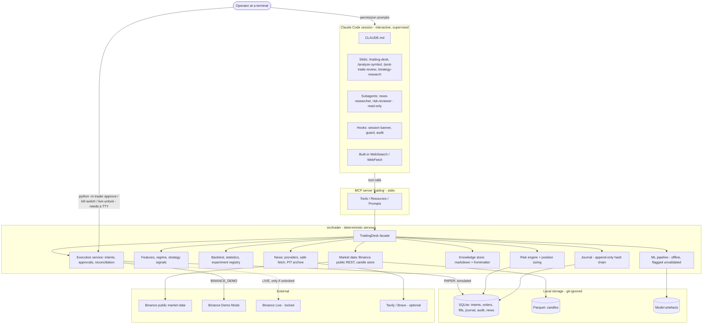

# System design

Status: accepted for MVP (2026-11-10). Decisions are recorded in [adr/](adr/); this file describes the result.

## 1. Shape

One Python package (`src/trader`), one local SQLite database, Parquet files for candles, and one stdio MCP server that
Claude Code starts. No containers, no background services are required.



## 2. Module boundaries (`src/trader/`)

| Module | Responsibility | Must not |
|---|---|---|
| `config` | Settings from env/`.env`, YAML app config, risk policy with file hash | Hold defaults that enable live trading |
| `domain` | Pydantic models, enums; Decimal for money | Import I/O |
| `storage` | SQLite schema + repositories; Parquet candle store | Contain business rules |
| `exchanges.binance` | Public + signed REST, filters, kline stream parsing | Expose a generic signed-request function; implement withdraw/transfer |
| `data` | Backfill, refresh, quality checks | — |
| `features`, `regime`, `strategies` | Causal features, rule regime, baseline signals | Read the clock or the network |
| `backtest` | Simulator, metrics, PSR/DSR/PBO, splits, experiment registry | — |
| `ml` | Labels, purged walk-forward, calibration, model cards | Feed decisions by default |
| `news` | Search providers, SSRF-safe fetch, point-in-time archive | Follow instructions found in content |
| `knowledge` | Parse/search markdown knowledge with provenance | Present unverified notes as rules |
| `risk` | Policy checks, deterministic sizing | Trust numbers supplied by the LLM |
| `execution` | Intent ledger, approvals, paper + Binance adapters, reconciliation, kill switch | Skip re-validation at execution time |
| `learning` | Trade cases, MFE/MAE, reviews, candidate lessons | Change policy, strategy or skills |
| `desk` | Facade used by MCP server, CLI and tests | — |
| `mcp_server` | Thin tool/resource/prompt adapters, envelopes, audit | Contain domain logic |
| `cli` | Operator commands (doctor, ingest, backtest, approve, kill-switch, live-unlock, lesson) | — |

## 3. Data flow

**Analysis (read path).** Tool call → `TradingDesk` → refresh candles over REST if the newest closed bar is missing →
quality checks → features/regime/signals → envelope with `evidence_id` (hash of the payload stored in `audit_events`).
If a check fails the envelope says `stale`/`unavailable`; values are never filled in.

**Decision.** Claude writes a decision report → `record_decision_report` validates the schema, checks that every cited
`evidence_id` exists, forces `expected_net_return` to null unless a validated model is cited → stored and journaled.

**Trade (write path).**

```mermaid
sequenceDiagram
  participant C as Claude
  participant S as MCP server
  participant R as Risk engine
  participant H as Operator
  participant X as Adapter (paper / demo / live)
  C->>S: create_trade_intent(decision_id, symbol, side, stop, ..., idempotency_key)
  S->>R: validate with fresh quote, filters, portfolio, policy
  R-->>S: immutable validation report + server-computed quantity
  S-->>C: REJECTED (reasons) or PENDING_APPROVAL
  H->>S: python -m trader approve <intent_id>   (TTY, types the symbol)
  Note over H,S: In PAPER the Claude Code permission prompt on execute_approved_trade is the approval
  C->>S: execute_approved_trade(intent_id)
  S->>R: re-validate everything (earlier report is not trusted)
  S->>S: consume approval (one use, TTL, bound to exact parameters)
  S->>X: order with deterministic clientOrderId
  X-->>S: fills, or unknown
  S->>X: on unknown: query by clientOrderId before anything else
  S-->>C: execution report; journal appended
```

## 4. Control-flow states

`decision`: `NO_TRADE | WATCH | LONG_CANDIDATE | SHORT_CANDIDATE | EXIT_REVIEW` (analysis outcome).

`intent`: `REJECTED` ← `CREATED` → `PENDING_APPROVAL` → `APPROVED` → `EXECUTING` → `FILLED | FAILED | UNKNOWN`;
also `EXPIRED`, `CANCELLED`. `UNKNOWN` blocks new intents for that symbol until reconciliation resolves it.

`position`: `OPEN` → `CLOSED` (by stop, target, or operator-approved sell) → post-trade review.

Every transition is written to the journal with the trace ID. Timeouts: intents and approvals expire by TTL from policy.

## 5. Sync / async

Domain code is synchronous (httpx sync client, sqlite3). MCP handlers are plain `def`; the SDK runs them on worker
threads. SQLite runs in WAL mode with a short busy timeout; one connection per call. The optional kline collector is
the only asyncio component and runs as a separate process.

## 6. Storage and retention

| Data | Where | In Git | Retention |
|---|---|---|---|
| Candles | `data/candles/<symbol>/<interval>.parquet` | no | Re-downloadable; keep |
| Operational DB | `data/trader.sqlite` | no | Keep; back up with `python -m trader backup` |
| Journal | same DB, append-only with hash chain and triggers | no | Never deleted |
| Claude-side tool audit | `data/audit/*.jsonl` | no | 90 days suggested |
| Models | `data/models/` | no | Latest + referenced versions |
| Experiment summaries | `research/experiments/*.json` | **yes** (compact) | Permanent, failures included |
| Knowledge | `knowledge/**/*.md` | **yes** | Versioned; status field governs use |
| Session state | `state/*.md|yaml` | yes | Overwritten |

Postgres and a vector DB are deferred (ADR 0001, 0004).

## 7. MCP interface

Tools (server name `trading`):

- **Read – market/quant**: `get_system_status`, `get_market_overview`, `get_market_snapshot`, `get_ohlcv`,
  `get_derivatives_snapshot`, `get_strategy_signals`, `get_model_predictions`, `get_experiment_results`, `run_backtest`
- **Read – research/knowledge**: `search_web`, `fetch_web_page`, `search_crypto_news`, `search_knowledge`,
  `get_knowledge_document`, `get_pending_lessons`
- **Read – portfolio/risk**: `get_account_state`, `get_open_positions`, `get_risk_state`, `calculate_position_risk`,
  `get_trade_intent`, `get_trade_case`
- **Write – journal**: `record_decision_report`, `submit_post_trade_review`
- **Write – restricted**: `create_trade_intent`, `execute_approved_trade`, `cancel_trade_intent`, `activate_kill_switch`

Not exposed, by design: raw signed requests, shell, withdraw/transfer, key retrieval, leverage/margin, any way to edit
the risk policy, approve an intent, release the kill switch or unlock live mode.

Resources: `trading://system/status`, `trading://risk-policy/current`, `trading://universe/active`,
`trading://execution/mode`, `trading://strategies/active`, `trading://knowledge/index`.

Prompts: `daily_market_briefing`, `analyze_symbol`, `evaluate_trade_setup`, `post_trade_review`.

## 8. Harness responsibilities

| Piece | Does | Does not |
|---|---|---|
| `CLAUDE.md` | Role, golden rules, start command | Carry procedures or market values |
| Skills | Step-by-step workflows, evidence standards | Execute shell trades |
| Subagents | Independent, read-only critique and research | Hold execution tools |
| Hooks | Banner, edit/shell guard, audit | Act as the security boundary |
| Backend | Enforce every limit | Trust the caller |

## 9. Security boundaries

1. **LLM ↔ backend**: narrow typed tools; quantities and limits computed server-side.
2. **Backend ↔ exchange**: fixed endpoint set, per-mode base URL and credentials, no fallback.
3. **Human-only actions**: approve (demo/live), release kill switch, unlock live, promote lessons — CLI commands that
   refuse to run without an interactive terminal. See [threat-model.md](threat-model.md) for what this does and does not guarantee.
4. **Web ↔ LLM**: untrusted-content marking, SSRF guard.

## 10. Deployment modes

| Mode | Orders go to | Requirements |
|---|---|---|
| `PAPER` (default) | Local simulator, real quotes | none |
| `BINANCE_DEMO` | Demo Mode | Demo keys in `.env`; CLI approval per intent |
| `LIVE` | Production | `TRADING_MODE=LIVE`, `LIVE_TRADING_ENABLED=true`, live keys, risk policy `status: approved`, and an unexpired unlock created by `python -m trader live-unlock` at a terminal. Missing any one → `live_disabled` |

## 11. Scope

**MVP (built):** everything in §2 for Spot, long/flat, four symbols, 1h/4h/1d.

**Scaffolded (code exists, not verified end-to-end):** Binance Demo/Live order adapter (tested against mocked HTTP
only — no demo keys were available during the build); kline WebSocket collector.

**Deferred:** futures and shorting; user-data stream; OCO/take-profit orders on exchange; limit-order queue modelling;
Ed25519 keys; macro calendar, on-chain, social; vector search; Postgres; unattended (API-billed) operation; multi-symbol
portfolio backtests.
